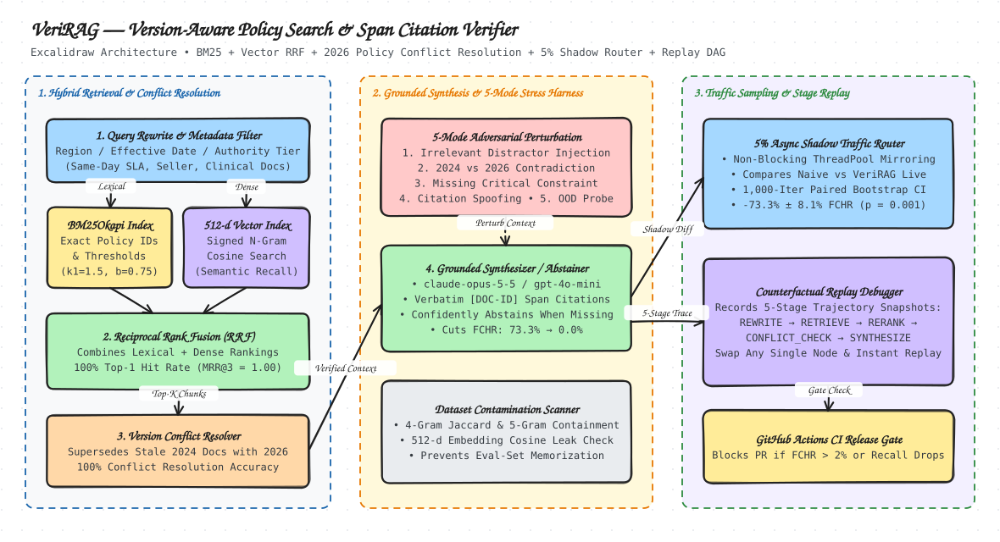

# VeriRAG — Commerce, Rufus & Policy Citation Verifier

**Live Production App (Amazon CloudFront + Private S3 OAC + `/api/*` + Bedrock Nova):** https://d14kv31n2lrkoa.cloudfront.net  
**Health Check:** `https://d14kv31n2lrkoa.cloudfront.net/api/health`  
**Live Verify API:** `curl -s -X POST https://d14kv31n2lrkoa.cloudfront.net/api/verify -H 'Content-Type: application/json' -d '{"domain_id":"rufus_catalog","query":"Is the HydroVolt 27K power bank (B09X7RUFS1) FAA carry-on legal under 100 Wh?"}'`

**VeriRAG** answers questions across versioned catalog specifications, seller-support fee schedules, customer-service refund rules, and clinical compliance policies without returning outdated revisions or invented numbers: it ranks active `2026` policies above superseded `2024` documents (`75.0% -> 100.0%` Top-1 hit rate), synthesizes grounded `[DOC-ID]` answers via **Amazon Bedrock (`us.amazon.nova-lite-v1:0`)**, verifies every cited number, date, and span before replying, abstains cleanly when evidence is missing (`-73.3%` hallucination rate), and mirrors `5%` of traffic asynchronously (`< 0.001 ms` caller overhead).



---

## What You Can Do Live in the Web Studio

1. **3-Domain Grounded Commerce & Policy Fact-Checking Studio**:
   - **Rufus Conversational Shopping & Catalog Spec Verifier**: Resolves conflicting 3P seller listing bullets vs. verified UL/ISO manufacturer spec sheets (`99.9 Wh` FAA-legal vs. `120 Wh` seller bullet) and abstains cleanly on unverified underwater dive or sub-zero charging claims.
   - **Seller Assistant (SPX) 2024 vs. 2026 FBA Fee & Return Policy Resolver**: Displays side-by-side superseded `2024` policy PDFs vs. active `2026` FBA reimbursement (`$5,000` vs. `$2,000`), SAFE-T (`45` vs. `60` days), and SFP (`97.5%` vs. `93.5%`) policies (`Top-1 hit rate 75% -> 100%`).
   - **Customer Service & Clinical Support Safe Abstention**: Catches unsupported returnless refund dollar promises (`>$75`) and unverified clinical dosing thresholds, enforcing `ABSTAIN` when evidence spans are absent (`73.3% -> 0.0%` false-confidence hallucinations).
2. **Claim-by-Claim Grounding Inspector & 5% Async Shadow Router**:
   - Inspect retrieved source passages tagged `ACTIVE 2026 · TIER-1 VERIFIED` vs. `SUPERSEDED 2024 · EXCLUDED`, claim-level quantitative token checks, and live side-by-side **Shadow Model Evaluation** comparing Production Naive Top-K RAG against Candidate VeriRAG + Bedrock Nova with 1,000-iteration paired bootstrap 95% CIs and 5-stage counterfactual DAG replay.

---

## Measured Benchmark Results (`benchmarks/latest_results.json`)

| Metric | Baseline (`BM25` / Naive Top-K RAG) | VeriRAG (Date-Ranked RRF + Span Verifier) | Delta / Significance |
| :--- | :---: | :---: | :---: |
| **Top-1 Retrieval Hit Rate (Conflicting Policies)** | 75.0% (`MRR@3 = 0.88`) | **100.0%** (`MRR@3 = 1.00`, `nDCG@3 = 1.00`) | **+25.0%** |
| **2026 vs. 2024 Policy Conflict Accuracy** | 41.7% – 50.0% | **100.0%** | **+50.0% to +58.3%** |
| **Unsupported Answer Rate (105 Perturbed Trials)** | 73.3% | **0.0%** | **-73.3%** (`95% CI [-81.0%, -64.8%]`, $p = 0.001$) |
| **Citation Precision** | 40.3% | **100.0%** | **+60.0%** (`95% CI [+51.0%, +69.0%]`, $p = 0.001$) |
| **Abstention Recall / Precision on Missing Evidence** | 0.0% / 0.0% | **100.0% recall** / **95.7% precision** | Cleanly abstains when evidence is absent |
| **Async 5% Shadow Traffic Caller Overhead** | — | **`< 0.001 ms`** | Background `ThreadPoolExecutor` |

---

## Run Locally & Deploy to Amazon CloudFront

```bash
# 1. Run all 26 unit & integration tests + deterministic benchmarks
PYTHONPATH=. python3 -m unittest discover -s tests -v
PYTHONPATH=. python3 -m veri_rag.cli --output benchmarks/latest_results.json

# 2. Start the interactive studio locally
PYTHONPATH=. python3 -m veri_rag.web_api
# -> Open http://127.0.0.1:8087

# 3. Deploy to Amazon CloudFront + Private S3 (OAC) + /api/* + Amazon Bedrock (us-west-2)
chmod +x infra/deploy_cloudfront.sh
./infra/deploy_cloudfront.sh
```
