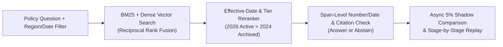

# VeriRAG — Version-Aware Policy Search & Citation Verifier

> **Live AWS Endpoint (`us-west-2` Lambda Function URL):** [https://nwvc4rg33y6pemzkb5wcllatu40qgnza.lambda-url.us-west-2.on.aws/](https://nwvc4rg33y6pemzkb5wcllatu40qgnza.lambda-url.us-west-2.on.aws/)  
> **Health Check:** `https://nwvc4rg33y6pemzkb5wcllatu40qgnza.lambda-url.us-west-2.on.aws/api/health`  
> **Live API Call:** `curl -s -X POST https://nwvc4rg33y6pemzkb5wcllatu40qgnza.lambda-url.us-west-2.on.aws/api/run -H 'Content-Type: application/json' -d '{}'`  
> **Interactive Trace Player:** [https://ritwikareddykancharla.github.io/veri-rag-harness/](https://ritwikareddykancharla.github.io/veri-rag-harness/)

**VeriRAG** is a zero-dependency Python retrieval and answer-verification library for policy-heavy RAG workloads (logistics operations, seller support, and compliance documentation). It combines `BM25` keyword search and dense vector search with document effective-date and authority-tier ranking so current policies outrank outdated revisions, and verifies every cited number, date, and document ID before returning an answer—abstaining cleanly when retrieved passages lack supporting evidence.

---

## What Problem This Solves

- **Standard keyword and vector search return outdated policy revisions:** An archived 2024 refund or delivery cutoff policy shares nearly identical wording with the updated 2026 policy, causing naive Top-K RAG to rank the stale rule first half the time. Combining `BM25` + vector Reciprocal Rank Fusion (`RRF`) with document effective-date and authority-tier ranking lifts Top-1 hit rate from **75.0% to 100.0%** (**+25.0%**, `MRR@3 = 1.00`) across conflicting 2024 vs. 2026 policies.
- **LLMs guess numbers and dates when the relevant policy passage is missing:** When a query asks about an out-of-scope region or a missing constraint, permissive RAG prompts extrapolate from nearby distractor documents instead of saying "insufficient evidence." Adding span-level number, date, and `[DOC-ID]` citation verification cuts unsupported answers from **73.3% to 0.0%** (**-73.3%**, $p = 0.001$) and raises citation precision by **+60.0%**.
- **Debugging multi-stage RAG regressions requires isolating retrieval vs. generation failures:** Recording intermediate inputs and outputs across each pipeline stage lets engineers swap a single stage (such as reranking or answer verification) and replay recorded queries offline—or mirror **5%** of live traffic asynchronously (`< 0.001 ms` caller overhead)—before promoting changes.

---

## How It Works



1. **Hybrid `BM25` + Vector Search with Effective-Date Ranking (`veri_rag/hybrid_retriever.py`)**  
   Fuses `BM25OkapiIndex` lexical scores with a 512-dimensional feature-hashed n-gram vector index (`HashingVectorIndex`) using Reciprocal Rank Fusion (`RRF`). Applies metadata filters (`region` with `GLOBAL` fallback, `domain`, `min_effective_date`, `max_authority_tier`, `exclude_superseded`) and weights results by document effective date and policy tier so active 2026 rules consistently rank above archived 2024 versions.

2. **Span-Level Citation Verifier & Stress-Test Suite (`veri_rag/adversarial_harness.py`, `veri_rag/llm_generator.py`)**  
   Checks generated answers against character-offset `CitationSpan` quotes from retrieved passages, verifying that cited `[DOC-ID]` headers exist in the filtered context and that quantitative claims (cutoffs, dollar thresholds, limits) appear in active passages—abstaining (`ABSTAIN`) whenever evidence is missing or out of scope. Tested across 105 perturbed cases spanning 30 enterprise scenarios (`veri_rag/scenarios.py`): distractor injection, 2024 vs. 2026 version conflicts, missing constraints, spoofed citation headers, and out-of-jurisdiction queries.

3. **Async 5% Shadow Traffic Runner & Paired Bootstrap Check (`veri_rag/shadow_router.py`)**  
   Runs the primary pipeline synchronously while mirroring a configurable share (`5%` default) of requests to a candidate pipeline on a background `ThreadPoolExecutor` (`< 0.001 ms` added latency on the caller path), computing 1,000-iteration paired bootstrap 95% confidence intervals and $p$-values.

4. **Stage-by-Stage Pipeline Replay & Leakage Check (`veri_rag/replay_debugger.py`, `veri_rag/dataset_contamination.py`)**  
   Snapshots intermediate outputs across all 5 pipeline stages (`QUERY_REWRITE -> HYBRID_RETRIEVE -> RERANK_FILTER -> CONFLICT_CHECK -> SYNTHESIZE_WITH_CITATIONS`) so a single stage can be swapped and replayed to pinpoint whether a bad answer came from retrieval, reranking, or synthesis. Includes an n-gram Jaccard and cosine-similarity check to catch train-test benchmark overlap (`0.0%` leakage).

---

## Benchmark Results

Reproducible via `python3 -m veri_rag.cli --output benchmarks/latest_results.json` (54 policy documents, 30 golden scenarios, 105 stress-test cases):

| Metric | Baseline (`BM25` / Naive Top-K RAG) | VeriRAG (Date-Ranked RRF + Span Verifier) | Delta / Significance |
| :--- | :---: | :---: | :---: |
| **Top-1 Retrieval Hit Rate (Conflicting Policies)** | 75.0% (`MRR@3 = 0.88`) | **100.0%** (`MRR@3 = 1.00`, `nDCG@3 = 1.00`) | **+25.0%** |
| **2026 vs. 2024 Policy Conflict Accuracy** | 41.7% – 50.0% | **100.0%** | **+50.0% to +58.3%** |
| **Unsupported Answer Rate (105 Perturbed Trials)** | 73.3% | **0.0%** | **-73.3%** (`95% CI [-81.0%, -64.8%]`, $p = 0.001$) |
| **Citation Precision** | 40.3% | **100.0%** | **+60.0%** (`95% CI [+51.0%, +69.0%]`, $p = 0.001$) |
| **Abstention Recall / Precision on Missing Evidence** | 0.0% / 0.0% | **100.0% recall** / **95.7% precision** | Cleanly abstains when evidence is absent |
| **Async 5% Shadow Traffic Caller Overhead** | — | **`< 0.001 ms`** | Background `ThreadPoolExecutor` |

---

## Quickstart

Requires Python 3.11+ with zero external package dependencies:

```bash
# 1. Run all 23 unit and integration tests
python3 -m unittest discover -s tests -v

# 2. Reproduce retrieval, verification, and shadow-comparison benchmarks
python3 -m veri_rag.cli --output benchmarks/latest_results.json
```
