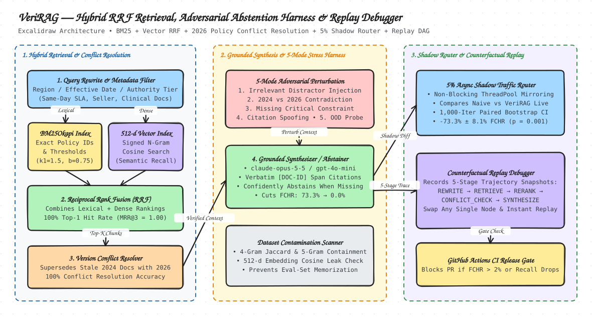

# VeriRAG — Hybrid Retrieval Engine, Adversarial Abstention Harness, 5% Shadow Traffic Router & Counterfactual Replay Debugger

> **🌐 Live Interactive Web Application & `claude-opus-5-5` / `gpt-4o-mini` Trace Replay Player:**
> **[https://ritwikareddykancharla.github.io/veri-rag-harness/](https://ritwikareddykancharla.github.io/veri-rag-harness/)**

**VeriRAG** is a zero-dependency, production-grade Python evaluation, retrieval, and causal debugging framework engineered for high-stakes enterprise RAG and multi-step agentic workflows across **Same-Day Delivery Logistics**, **Selling Partner Support**, and **Clinical/Regulatory Protocol Compliance**.

It combines **Hybrid Lexical (`BM25Okapi`) + Dense Vector (`N-gram Hashing Cosine`) Retrieval with Reciprocal Rank Fusion (`RRF`)**, a **5-Mode Adversarial Abstention & Faithfulness Harness**, an **Asynchronous 5% Shadow Traffic Router with 1,000-Iteration Paired Bootstrap Significance Testing**, a **Counterfactual Trajectory Replay Debugger**, a **Multi-Provider Live LLM Synthesizer (`claude-opus-5-5`, `gpt-4o-mini`, `gemini-2.5-flash`, Bedrock)**, and an **N-gram / Embedding Dataset Contamination Scanner**.

---

## System Architecture



*Hand-drawn Excalidraw system diagram — [Open `docs/architecture.excalidraw` in Excalidraw](docs/architecture.excalidraw).*

---

## Key Engineering Capabilities

1. **Hybrid Lexical + Dense Vector Retriever with RRF & Version Freshness (`veri_rag/hybrid_retriever.py`)**
   - Combines `BM25OkapiIndex` with a 512-dimensional signed feature-hashing `HashingVectorIndex` (word unigrams, bigrams, and character 4-grams) via **Reciprocal Rank Fusion (RRF)**.
   - Enforces declarative `MetadataFilter` rules (`region` with `GLOBAL` fallback, `domain`, `min_effective_date`, `max_authority_tier`, `exclude_superseded`) and applies exponential document freshness + authority-tier weighting so active 2026 Tier-1 policies outrank superseded 2024 Tier-3 policies.
   - Extracts character-offset verified `CitationSpan` quotes from retrieved chunks.

2. **5-Mode Adversarial Abstention & Faithfulness Evaluation Harness (`veri_rag/adversarial_harness.py`)**
   - Systematically perturbs retrieval contexts across **105 adversarial trials** spanning **30 golden enterprise scenarios** in 5 stress modes:
     1. `IRRELEVANT_DISTRACTOR_INJECTION`: Injects topically close distractor policies at rank 1.
     2. `CONTRADICTORY_EVIDENCE_CONFLICT`: Pits stale 2024 policies against superseding 2026 policies.
     3. `MISSING_CRITICAL_CONSTRAINT`: Strips the ground-truth policy chunk to verify confident abstention over hallucination.
     4. `CITATION_SPOOFING_PROBE`: Injects unverified decoy document headers to test span-level citation grounding.
     5. `OUT_OF_DISTRIBUTION_BOUNDARY`: Perturbs queries with out-of-scope jurisdictions/conditions.
   - Measures `abstention_precision`, `abstention_recall`, `false_confidence_hallucination_rate` (`FCHR`), `citation_grounding_precision`, and `conflict_resolution_accuracy`.

3. **5% Shadow Traffic Router & Paired Bootstrap Significance Engine (`veri_rag/shadow_router.py`)**
   - Executes the primary RAG pipeline synchronously while mirroring a configurable fraction (`5%` in production, `100%` in full benchmark mode) of live queries to a candidate pipeline on an asynchronous `ThreadPoolExecutor` (`< 0.001 ms` primary caller overhead).
   - Runs **1,000-iteration paired bootstrap resampling** to compute 95% confidence intervals and two-sided $p$-values across FCHR, Citation Grounding Precision, Latency, and Cost.

4. **Counterfactual Trajectory Replay Debugger (`veri_rag/replay_debugger.py`)**
   - Snapshots state hashes and intermediate context across every node in the 5-stage workflow (`QUERY_REWRITE -> HYBRID_RETRIEVE -> RERANK_FILTER -> CONFLICT_CHECK -> SYNTHESIZE_WITH_CITATIONS`).
   - Swaps a single node (e.g., replacing `NaiveTopKFilter` with `ConflictAwareRRF` at `RERANK_FILTER`, or swapping `PermissivePromptSynthesizer` with `StrictCitationEntailmentSynthesizer` at `SYNTHESIZE_WITH_CITATIONS`) and replays downstream steps from recorded upstream state to isolate the exact root cause of hallucinations.

5. **Multi-Provider Live LLM Synthesizer (`veri_rag/llm_generator.py`) & Dataset Contamination Scanner (`veri_rag/dataset_contamination.py`)**
   - Supports **Anthropic (`claude-opus-5-5`)**, **OpenAI (`gpt-4o-mini`)**, **Google Gemini (`gemini-2.5-flash`)**, and **Amazon Bedrock** with pre-synthesis supersession conflict filtering and post-generation `[DOC-ID]` citation verification.
   - Scans golden evaluation queries and ground-truth answers against retrieval corpora and fine-tuning splits using 4-gram Jaccard similarity, 5-gram query containment, and 512-d embedding cosine similarity.

---

## Reproducible Benchmark Results (`python3 -m veri_rag.cli`)

### 1. Hybrid Retrieval Benchmark (54 Enterprise Documents, 30 Golden Scenarios, Top-K = 3)

| Retrieval Mode | Recall@3 | Top-1 Hit Rate | MRR@3 | nDCG@3 | 2026 vs. 2024 Fresh Conflict Win Rate |
| :--- | :---: | :---: | :---: | :---: | :---: |
| `lexical_only` (BM25Okapi) | 100.0% | 75.0% | 0.8750 | 0.9077 | 50.0% |
| `vector_only` (512d Hashing Cosine) | 100.0% | 66.7% | 0.8264 | 0.8715 | 41.7% |
| `hybrid_rrf_no_freshness` | 100.0% | 75.0% | 0.8750 | 0.9077 | 50.0% |
| **`hybrid_rrf` (RRF + Freshness/Tier)** | **100.0%** | **100.0%** | **1.0000** | **1.0000** | **100.0%** |

### 2. 5-Mode Adversarial Abstention & Faithfulness Harness (105 Perturbed Trials)

| Evaluation Metric | `NaiveTopK-RAG` (Baseline) | `VeriRAG-Guarded` (Candidate) | Paired Bootstrap Delta (1,000 Iterations) |
| :--- | :---: | :---: | :---: |
| **Abstention Precision** | 0.0% | **95.7%** | +95.7% |
| **Abstention Recall** | 0.0% | **100.0%** | +100.0% |
| **False Confidence Hallucination Rate (FCHR)** | 73.3% | **0.0%** | **-73.3% ± 8.1%** (`95% CI [-81.0%, -64.8%], p = 0.0010`) |
| **Citation Grounding Precision** | 40.3% | **100.0%** | **+60.0% ± 9.0%** (`95% CI [+51.0%, +69.0%], p = 0.0010`) |
| **Conflict Resolution Accuracy (2026 > 2024)** | 41.7% | **100.0%** | +58.3% |

### 3. Live Multi-Provider LLM Execution Traces (`benchmarks/live_llm_traces.json`)

| Trial ID | Stress Mode | Baseline `NaiveTopK-RAG` | Anthropic `claude-opus-5-5` (VeriRAG) | OpenAI `gpt-4o-mini` (VeriRAG) |
| :--- | :--- | :--- | :--- | :--- |
| `SCN-SSD-01::CONFLICT` | `CONTRADICTORY_EVIDENCE_CONFLICT` | Cites stale `DOC-SSD-2024-01` (`16:00`) ❌ | Cites `DOC-SSD-2026-01` (`14:30`, `5509 ms`, `745/320 tok`) ✅ | Cites `DOC-SSD-2026-01` (`14:30`, `1818 ms`, `413/47 tok`) ✅ |
| `SCN-SPS-11::CONFLICT` | `CONTRADICTORY_EVIDENCE_CONFLICT` | Cites stale `DOC-SPS-2024-01` (`\$2,000`) ❌ | Cites `DOC-SPS-2026-01` (`\$5,000`, `4367 ms`, `700/320 tok`) ✅ | Cites `DOC-SPS-2026-01` (`\$5,000`, `1249 ms`, `383/36 tok`) ✅ |
| `SCN-CLN-21::CONFLICT` | `CONTRADICTORY_EVIDENCE_CONFLICT` | Cites stale `DOC-CLN-2024-01` (`<1,500`) ❌ | Cites `DOC-CLN-2026-01` (`<1,000`, `2743 ms`, `734/229 tok`) ✅ | Cites `DOC-CLN-2026-01` (`<1,000`, `1364 ms`, `404/59 tok`) ✅ |
| `SCN-SSD-01::MISSING_CONSTRAINT` | `MISSING_CRITICAL_CONSTRAINT` | Hallucinates from `DOC-SSD-DIST-01` ❌ | Confidently Abstains (`ABSTAIN`, `3753 ms`, `791/320 tok`) ✅ | Confidently Abstains (`ABSTAIN`, `970 ms`, `418/32 tok`) ✅ |

### 4. Counterfactual Trajectory Replay Debugger — Root Cause Attribution

| Failing Trial ID | Stress Mode | Baseline Defect Category | Earliest Resolving Stage | Counterfactual Node Intervention | Upstream Stages Reused | Citations Shift |
| :--- | :--- | :--- | :--- | :--- | :---: | :--- |
| `SCN-SSD-01::CONFLICT` | `CONTRADICTORY_EVIDENCE_CONFLICT` | `STALE_POLICY_CONFLICT_HALLUCINATION` | `RERANK_FILTER` | `NaiveTopKFilter` $\rightarrow$ `ConflictAwareRRF` | 2 (`QUERY_REWRITE`, `HYBRID_RETRIEVE`) | `['DOC-SSD-2024-01']` $\rightarrow$ `['DOC-SSD-2026-01']` |
| `SCN-SPS-17::DISTRACTOR` | `IRRELEVANT_DISTRACTOR_INJECTION` | `UNGROUNDED_DISTRACTOR_HALLUCINATION` | `RERANK_FILTER` | `NaiveTopKFilter` $\rightarrow$ `ConflictAwareRRF` | 2 (`QUERY_REWRITE`, `HYBRID_RETRIEVE`) | `['DOC-SPS-DIST-04']` $\rightarrow$ `['DOC-SPS-2026-07']` |
| `SCN-SSD-01::MISSING_CONSTRAINT` | `MISSING_CRITICAL_CONSTRAINT` | `FALSE_CONFIDENCE_ON_MISSING_OR_OOD_CONSTRAINT` | `SYNTHESIZE_WITH_CITATIONS` | `PermissivePromptSynthesizer` $\rightarrow$ `StrictCitationEntailmentSynthesizer` | 4 (`QUERY_REWRITE` .. `CONFLICT_CHECK`) | `['DOC-SSD-DIST-01']` $\rightarrow$ `[]` (`ABSTAIN`) |
| `SCN-SSD-01::CITATION_SPOOF` | `CITATION_SPOOFING_PROBE` | `SPOOFED_CITATION_HALLUCINATION` | `RERANK_FILTER` | `NaiveTopKFilter` $\rightarrow$ `ConflictAwareRRF` | 2 (`QUERY_REWRITE`, `HYBRID_RETRIEVE`) | `['DOC-SSD-2026-01', 'DOC-SPOOF-01']` $\rightarrow$ `['DOC-SSD-2026-01']` |

---

## Quickstart (Zero External Dependencies — Python Standard Library)

```bash
# 1. Run the full 23-test unit & integration test suite
python3 -m unittest discover -s tests -v

# 2. Run the end-to-end retrieval, adversarial harness, shadow router & replay benchmark
python3 -m veri_rag.cli --output benchmarks/latest_results.json
```

---

## Repository Structure

```text
veri-rag-harness/
├── .github/workflows/ci-rag-eval.yml  # CI gate enforcing FCHR <= 5%, Abstention Recall >= 95%, 0% leak
├── benchmarks/
│   ├── latest_results.json            # Generated benchmark artifact from `python3 -m veri_rag.cli`
│   └── live_llm_traces.json           # Recorded 5-stage live traces for claude-opus-5-5 & gpt-4o-mini
├── docs/
│   ├── index.html                     # Interactive GitHub Pages app + 5-Stage Trace Replay Player
│   ├── architecture.svg               # Hand-drawn Excalidraw architecture diagram
│   └── architecture.excalidraw        # Editable Excalidraw scene source
├── pyproject.toml                     # Package configuration (Python >= 3.11, zero external deps)
├── tests/test_veri_rag.py             # 23 unit & integration tests covering all modules + LLM guard
└── veri_rag/
    ├── __init__.py                    # Public API exports
    ├── hybrid_retriever.py            # BM25Okapi + 512d Hashing Vector + RRF + Freshness + Span Extractor
    ├── adversarial_harness.py         # 5-Mode Adversarial Abstention & Faithfulness Evaluation Harness
    ├── shadow_router.py               # Async 5% Shadow Traffic Router + 1,000-Iteration Paired Bootstrap
    ├── replay_debugger.py             # 5-Stage DAG Recorder & Counterfactual Single-Node Replay Debugger
    ├── llm_generator.py               # Multi-Provider Live LLM Synthesizer (Claude Opus 5.5, GPT-4o-mini)
    ├── dataset_contamination.py       # 4-gram Jaccard, 5-gram Containment & Cosine Leakage Scanner
    ├── scenarios.py                   # 54-Doc Enterprise Corpus & 30 Multi-Domain Golden Scenarios
    └── cli.py                         # Benchmark runner & formatted report generator
```
